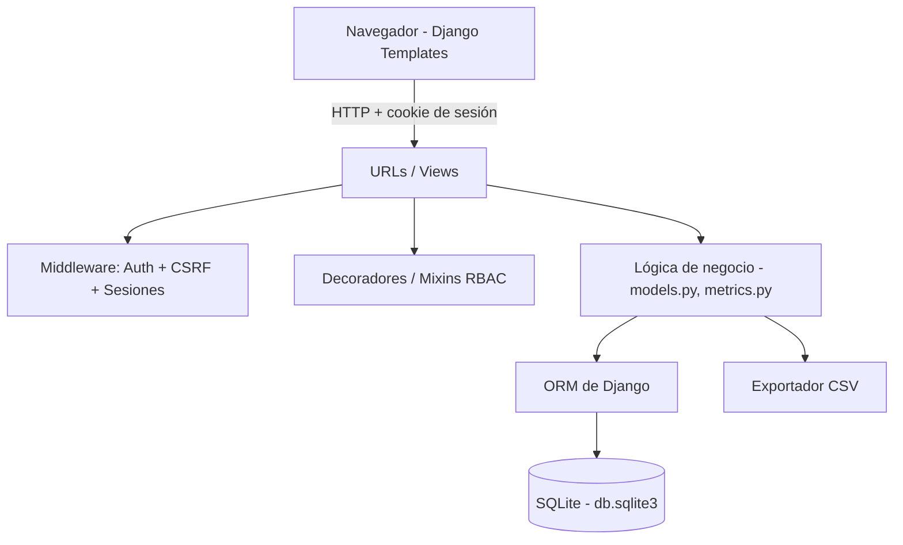
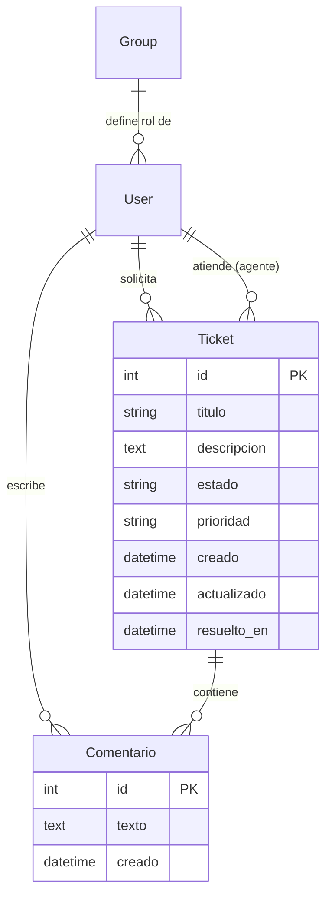
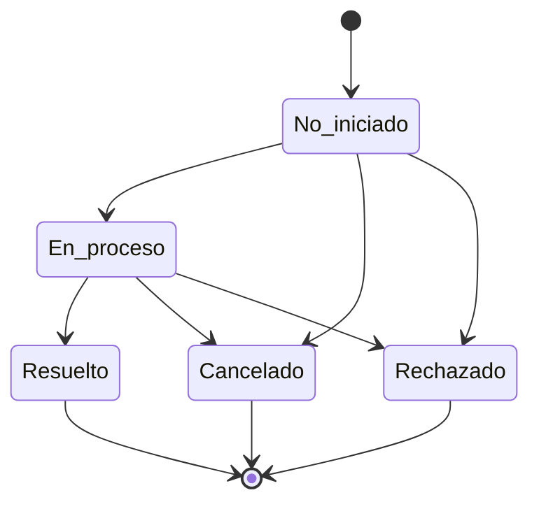

# Documentación de Arquitectura y Decisiones Técnicas

**Proyecto:** Sistema de Tickets de Trabajo de TI (estilo Jira)

Este documento explica **qué tecnologías se usaron, por qué**, y **cómo está
organizada la arquitectura** del sistema.

---

## 1. Resumen del sistema

Una aplicación web para gestionar tickets de soporte de TI. Permite:

- Registrar tickets de solicitud de trabajo.
- Iniciar sesión con manejo de sesiones.
- Gestionar usuarios y roles (Admin, Agente, Solicitante).
- Mover tickets a través de un flujo de estados controlado.
- Visualizar un dashboard de analítica y exportar tablas a CSV.

---

## 2. Stack tecnológico y justificación

| Capa | Tecnología | Por qué se eligió |
|------|-----------|-------------------|
| Lenguaje backend | **Python 3.10+** | Requisito del proyecto. Ecosistema maduro, legible y con amplio soporte. |
| Framework web | **Django 5.2 LTS** | "Baterías incluidas": trae ORM, autenticación, sesiones, permisos y panel de administración de fábrica. Es la versión LTS vigente (soporte hasta abril 2028), lo que da estabilidad. |
| Base de datos | **SQLite** | Cero configuración: es un único archivo (`db.sqlite3`). Ideal para desarrollo y demostración. Django permite migrar a PostgreSQL/MySQL cambiando solo `DATABASES`. |
| Frontend | **Django Templates (renderizado en servidor)** | Mantiene todo el proyecto en un solo stack de Python, sin necesidad de un framework JS aparte. Menos complejidad y menos piezas móviles. |
| Estilos | **CSS plano** | Sin dependencias externas; carga rápida y fácil de mantener para el alcance del proyecto. |
| Exportación | **Módulo `csv` de la librería estándar** | No requiere dependencias extra y se integra directo con `HttpResponse`. |

### ¿Por qué Django y no Flask o FastAPI?

Para este dominio concreto (usuarios, roles, permisos, sesiones y un panel
administrativo), Django resuelve de forma nativa gran parte de los requisitos:

- **Autenticación y sesiones**: `django.contrib.auth` + `django.contrib.sessions`.
- **Roles y permisos (RBAC)**: sistema de `Groups` y `Permissions` incorporado.
- **Admin panel**: interfaz administrativa automática para gestionar datos.
- **Seguridad**: protección CSRF, hashing de contraseñas y validadores incluidos.

Con Flask o FastAPI habría que ensamblar y mantener manualmente cada una de
estas piezas, lo que añade trabajo y superficie de error sin beneficio para
este caso de uso.

---

## 3. Arquitectura general

El sistema sigue el patrón **MVT (Model–View–Template)** propio de Django, que
es su variante del clásico MVC.



### Organización en apps de Django

El proyecto se divide en apps con responsabilidades claras (alta cohesión,
bajo acoplamiento):

```
tickets-system/
├── config/        # Configuración del proyecto (settings, urls, wsgi/asgi)
├── accounts/      # Usuarios, roles, autenticación y gestión de usuarios
├── tickets/       # Modelo de ticket, flujo de estados, CRUD y comentarios
├── dashboard/     # Métricas de analítica y exportación a CSV
├── core/          # Utilidades y comando de datos de prueba (seed)
├── templates/     # Plantillas HTML (renderizado en servidor)
└── static/        # Archivos estáticos (CSS)
```

| App | Responsabilidad |
|-----|-----------------|
| `accounts` | Login/logout con sesiones, definición de roles, decoradores/mixins de control de acceso (RBAC) y pantallas de gestión de usuarios. |
| `tickets` | Modelo `Ticket` y `Comentario`, máquina de estados, vistas de CRUD y control de acceso por rol. |
| `dashboard` | Cálculo de métricas (`metrics.py`) y vistas de exportación CSV. |
| `core` | Comando `seed` para precargar datos de prueba. |

---

## 4. Modelo de datos



- Se reutiliza el modelo **`User`** nativo de Django (no se crea uno custom)
  para aprovechar toda su maquinaria de autenticación.
- Los **roles se modelan como `Group`** de Django. Un usuario pertenece a un
  grupo (Admin, Agente o Solicitante), y cada grupo tiene permisos asociados.
- El `Ticket` tiene dos relaciones con `User`: `solicitante` (quién lo creó) y
  `agente` (quién lo atiende).

---

## 5. Roles y control de acceso (RBAC)

Se definen tres roles como grupos de Django:

| Rol | Capacidades |
|-----|-------------|
| **Admin** | Gestiona usuarios y roles, ve todos los tickets, cambia estados, accede al dashboard y al admin de Django. |
| **Agente** | Ve todos los tickets, se asigna tickets, cambia estados, accede al dashboard. |
| **Solicitante** | Crea tickets y consulta **solo los suyos**. No cambia estados ni ve el dashboard. |

El control se aplica en varias capas:

1. **`@login_required`**: exige sesión iniciada.
2. **Decoradores/mixins propios** (`accounts/permissions.py`): `admin_requerido`
   y `staff_tickets_requerido` lanzan `PermissionDenied` (HTTP 403) si el rol
   no es suficiente.
3. **Filtrado de datos**: un Solicitante solo recibe en sus consultas los
   tickets que él creó (`_tickets_visibles`).

Los grupos y sus permisos se crean automáticamente mediante una **migración de
datos** (`accounts/migrations/0001_crear_roles.py`), por lo que no hay que
configurarlos a mano.

---

## 6. Flujo de estados del ticket (máquina de estados)



- Las transiciones válidas se definen de forma explícita en
  `tickets/models.py` (diccionario `TRANSICIONES_VALIDAS`).
- `Ticket.cambiar_estado()` **valida** la transición y lanza
  `TransicionInvalidaError` si no está permitida (p. ej., pasar de *Resuelto*
  de vuelta a *No iniciado*).
- Al llegar a *Resuelto* se registra automáticamente `resuelto_en`, lo que
  permite calcular el **tiempo promedio de resolución**.
- Solo **Admin** y **Agente** pueden cambiar estados.

---

## 7. Dashboard y exportación CSV

La lógica de métricas vive en `dashboard/metrics.py`, separada de las vistas
para poder probarla de forma aislada. Métricas calculadas con el ORM
(`Count`, `Avg`, filtros por fecha):

- Totales de tickets por estado y por prioridad.
- Usuarios por rol y tickets por agente.
- Tickets creados en los últimos 30 días.
- Tiempo promedio de resolución (en horas).
- Tickets abiertos vs cerrados.

La **exportación CSV** usa el módulo estándar `csv` escribiendo directamente a
un `HttpResponse` con `Content-Disposition: attachment`. Se añade un BOM UTF-8
para que Excel reconozca correctamente los acentos. Se pueden exportar las
tablas de **tickets**, **usuarios** y el **resumen de métricas**.

---

## 8. Seguridad

- **Sesiones nativas de Django** con cookie de sesión (expiración a 8 horas).
- **Protección CSRF** activa en todos los formularios (``).
- **Hashing de contraseñas** y validadores de robustez incluidos por Django.
- **Validación de redirección** (`next`) para evitar *open redirects*.
- Nota: `SECRET_KEY` y `DEBUG` están pensados para desarrollo. En producción
  deben cargarse desde variables de entorno y `DEBUG` debe ser `False`.

---

## 9. Pruebas

Cada app incluye pruebas automatizadas (`tests.py`):

- `accounts`: creación de grupos/permisos, login exitoso y fallido, acceso
  denegado sin sesión, alta de usuarios por Admin y bloqueo a no-Admin.
- `tickets`: transiciones válidas e inválidas de la máquina de estados y
  control de acceso por rol.
- `dashboard`: cálculo correcto de métricas y formato/permisos de la
  exportación CSV.

Ejecución: `python manage.py test`

---

## 10. Posibles mejoras futuras

- Migrar a PostgreSQL para producción.
- Notificaciones por correo al cambiar el estado de un ticket.
- Adjuntar archivos a los tickets.
- Gráficas visuales en el dashboard (Chart.js).
- API REST con Django REST Framework para integraciones externas.
